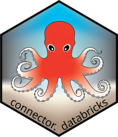

<!-- README.md is generated from README.Rmd. Please edit that file -->

# connector.databricks <a href="https://novonordisk-opensource.github.io/connector.databricks/"></a>

<!-- badges: start -->

[](https://github.com/novonordisk-opensource/connector.databricks/actions/workflows/check_and_co.yaml)
[](https://app.codecov.io/gh/NovoNordisk-OpenSource/connector.databricks)
[](https://lifecycle.r-lib.org/articles/stages.html#experimental)
<!-- badges: end -->

The connector.databricks package provides a convenient interface for
accessing and interacting with [Databricks](https://www.databricks.com/)
volumes and tables directly from R.

This package is meant to be used with
[connector](https://github.com/NovoNordisk-OpenSource/connector)
package, which provides a common interface for interacting with various
data sources. The connector.databricks package extends the connector
package to support Databricks **tables** and **volumes** through three
connectors:

- `connector_databricks_sql()`: tables, using a SQL warehouse through
  the [brickster](https://github.com/databrickslabs/brickster)
  `DatabricksSQL()` driver. This is the preferred way of working with
  tables.
- `connector_databricks_table()`: tables, using a cluster through the
  `odbc::databricks()` driver.
- `connector_databricks_volume()`: files in Unity Catalog volumes, using
  brickster.

## Installation

You can install the connector.databricks from CRAN package using the
following command:

``` r
# Install from CRAN
install.packages("connector.databricks")
```

### Development version

To get a bug fix or to use a feature from the development version, you
can install the development version of connector.databricks from GitHub.

``` r
pak::pak("novonordisk-opensource/connector.databricks")
```

## Usage

``` r
library(connector.databricks)

tables <- connector_databricks_sql(
  warehouse_id = "your-warehouse-id",
  catalog = "my_catalog",
  schema = "my_schema"
)

volume <- connector_databricks_volume(
  catalog = "my_catalog",
  schema = "my_schema",
  path = "path-to-file-storage"
)

tables |>
  write_cnt(mtcars, "mtcars")

tables |>
  read_cnt("mtcars")

volume |>
  write_cnt(iris, "iris.csv")
```

Credentials are read from the environment by the brickster package, for
example `DATABRICKS_HOST` and `DATABRICKS_TOKEN`. See
[Authentication](https://novonordisk-opensource.github.io/connector.databricks/articles/authentication.html)
for how to set this up locally, on Posit Workbench and on Posit Connect.

To work with tables through a cluster with the `odbc::databricks()`
driver, use `connector_databricks_table()`. See [Choosing between
ConnectorDatabricksSQL and
ConnectorDatabricksTable](https://novonordisk-opensource.github.io/connector.databricks/articles/table-vs-sql.html)
for how the two table connectors differ.

The connectors can also be created from a configuration file with
`connector::connect()`. See the [getting started
vignette](https://novonordisk-opensource.github.io/connector.databricks/articles/connector-databricks.html)
for an example.

## Contributing

We welcome contributions to the connector.databricks package. If you
have any suggestions or find any issues, please open an issue or submit
a pull request on GitHub.

## License

This package is licensed under the Apache License.
